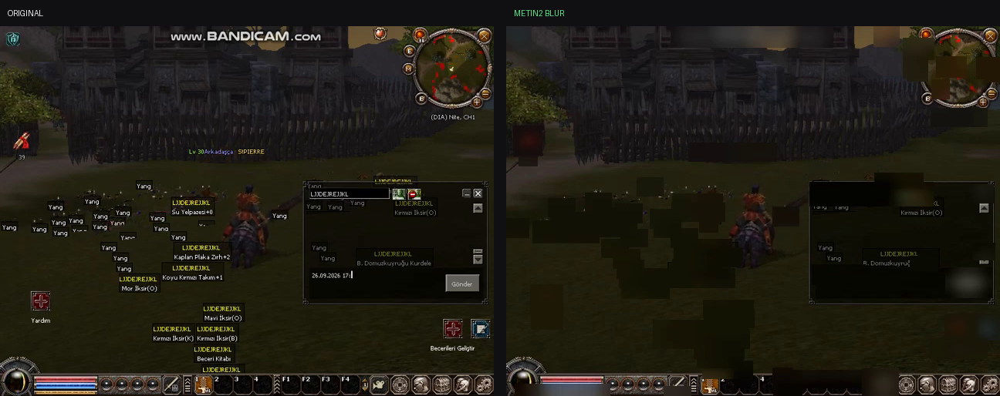
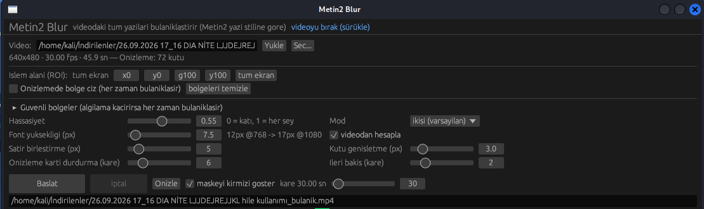
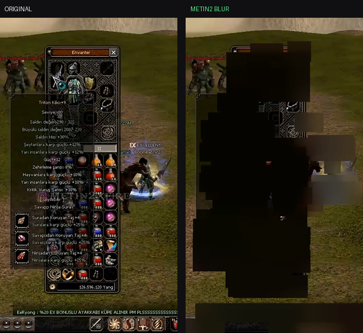

<div align="center">

# Metin2 Blur

**Local, offline video text redaction tool — tuned for Metin2 footage.**
Single-file Windows executable. Nothing is uploaded anywhere.

[English](README.md) · [Türkçe](README.tr.md)

</div>



*Left: original 640×480 Metin2 capture. Right: the same frame after redaction — nameplates,
floating damage numbers, chat and HUD labels are blurred. [Full demo video →](https://github.com/kaplan-025/metin2-blur/releases/download/v1.0.0/demo-redacted.mp4)*



*Regions drawn on the preview (orange) are blurred unconditionally; green boxes are what automatic detection found at that frame.*

---

## What it does

Takes a video file, finds the on-screen **text**, and blurs those regions in the
output. Useful for redacting names, chat, and account identifiers from
gameplay recordings before you share them — for bug reports, tickets to game
support, VODs, or anything else where you do not want bystanders' or your own
account names visible.

It is a **redaction aid, not a guarantee**. Read [Limitations](#limitations)
before you rely on it for anything sensitive, and re-check the output.

## Why it works on Metin2 footage

Detection is not OCR — no character recognition, no cloud, no model download.
From the leaked client sources, Metin2 renders text in a very specific way:

* `EterLib/GrpFontTexture.cpp` — glyphs are rasterised with
  `ANTIALIASED_QUALITY`, **thresholded to a 1-bit mask**, uploaded as
  `A4R4G4B4` and colour-modulated at draw time. On screen that means *flat
  colour with soft edges*, not a texture.
* `EterLib/GrpText.cpp` — font resources are `name:12.fnt`, `14i.fnt` (italic),
  `18.fnt`; the default size is **12 px**.
* `UserInterface/PythonTextTail.cpp` — nameplates use `SetOutline(true)` (black
  outline) and draw a dark box behind the text, and the colours are a fixed
  list (white player, red monster, `0xFFEFD4FF` guild, `CD661D`/`FFC125` guild
  levels, `00FF7F`…`FF4500` level colours …).

The pipeline follows from that:

```
frame → grayscale opening (erode→dilate) → top-hat / black-hat   ← thin-stroke response
      ∪ Metin2 palette core match (5-bit LUT)                     ← colour-based recall
      → horizontal run merge → connected components → line split
      → size / density / row-gap / temporal-stability filters
      → box blur per region → re-encode with ffmpeg
```

A *grayscale opening* is the key operator: unlike a plain local-contrast
measure, it deletes thick bright areas (sky, UI panels) while **preserving the
gaps between glyph strokes**, which is what makes it survive video compression
and upscaling.

> The palette match alone is **not** enough: H.264 with `yuv420p` chroma
> subsampling shifts flat colours, so `(255,204,0)` gold drifts measurably away
> from the reference value. That is why the structure channel carries the
> detection and the palette only adds recall.

## Portrait captures (720x1280 phone recording)



On phone/portrait recordings the text drops to 10-12 px. Character name, item
tooltip, Yang counter and chat were fully redacted in the measurement; part of a
nameplate over bright scene texture can still survive (see
[Limitations](#limitations)).

## Install

**Windows** — download `Metin2Blur.exe` from the releases page. That is the
whole install: no ffmpeg, no Python, no redistributables. `ffmpeg.exe` is
embedded in the binary and extracted to `%LOCALAPPDATA%\metin2-blur\` on first
run. (If Windows SmartScreen warns on a freshly downloaded unsigned file, click
*More info → Run anyway*.)

**Linux** — needs ffmpeg on `PATH`:

```bash
cargo build --release
./target/release/metin2-blur
```

## Use

1. Drop the video onto the window, or paste a path and press **Yukle / Load**.
2. Press **Onizle / Preview** — one frame is decoded, the detected text mask is
   drawn red and the boxes green. This is the step that matters: if a name you
   care about is not boxed, draw a region over it.
3. Optionally set **Islem alani (ROI)** to the game window so wallpaper,
   desktop widgets and other windows are ignored entirely.
4. Press **Baslat / Start**. The progress bar shows `frame n/total`, speed, the
   number of detected regions and an ETA. **Iptal / Cancel** stops it.

### Regions: the reliable path

Metin2's UI is at a **fixed position**, so a plain rectangle is often more
reliable than automatic detection — and it never has false positives:

* enable **Onizlemede bolge ciz / Draw region on preview** and drag a rectangle
  over the chat, the HUD, the inventory, whatever you need; up to 4 regions.
* Each region is blurred **unconditionally** on every frame.

### Command line

```
Metin2Blur.exe --cli <video> [output] [sensitivity] [font_px] [roi] [mode] [regions]

  sensitivity  0 = strict, 1 = catch everything        (default 0.55)
  font_px      expected text height in video pixels   (default: 12 × height/768)
  roi          x,y,w,h in percent of the frame        (0,0,100,100 = whole frame)
  mode         both | palet | yapi(structure)
  regions      x,y,w,h;x,y,w,h in percent — always blurred

example:
  Metin2Blur.exe --cli game.mp4 out.mp4 0.8 12 0,0,100,100 both 0,46,55,30;16,7,20,5
```

`FFMPEG=/path/to/ffmpeg` overrides the embedded binary.

## Limitations

Measured, not guessed — please read this part:

* **Automatic detection is not 100 % — measured.** Two hard cases in Metin2:
  * *Nameplates over a bright, textured 3D scene:* on a vertical 720×1280
    capture the right half of the nameplate is redacted and the left half can
    survive at %31 legibility. Reason: the dark-red glyphs (81,35,25) sit right
    on the detection threshold over bright grass (response p90 = 59) and merge
    with the scene texture.
  * *Desktop capture with a small game window:* 8 px text and 3D texture have
    overlapping contrast distributions, so some floating labels get through.
  → Use **regions** for both (below); the game layout is fixed, so it is the
  most reliable method. Measured improvement in v1.0.1 on the 720×1280 clip:
  character name %4.5→%0.0, item tooltip %1.8→%0.2, Yang counter %9.6→%0.0,
  chat %0→%0.
* It is much stronger on a full-screen capture (tested: 7/7 text regions reduced
  to 0.01–0.04 of original sharpness, no false positives on the UI panel).
* **Use regions for anything that must not be readable.** That is what the
  fixed game layout is for.
* Over-blurring is the failure mode: on textured scenes the tool can smear
  parts of the 3D scenery. Lower the sensitivity if that bothers you, or
  restrict the ROI.
* Text taller than ~3.2 × `font_px` is treated as a UI panel and skipped.
* 12 characters of palette tolerance is the practical floor (5-bit LUT).

## Speed

Measured end-to-end (release build, AMD Ryzen 5 1600, 4 cores, ffmpeg
decode+encode included). "1/N" = detection runs every Nth frame and the frames
in between reuse the last boxes (`--cli ... 1/N`, or the *Detection every N
frames* slider in the GUI).

| Video | 1/1 | 1/2 | 1/3 |
|---|---|---|---|
| 640x480, 30 fps, 45.9 s | **23.2 s** (2.0x realtime) | 18.1 s (2.5x) | 16.3 s (2.8x) |
| 720x1280, 30 fps, 6.6 s | 8.8 s (0.75x) | **6.6 s** (1.0x) | 6.0 s (1.1x) |
| 1920x1080, 30 fps, 6.6 s | 17.7 s (0.37x) | 13.3 s (0.49x) | 11.9 s (0.55x) |

Per frame at 720x1280: 20 ms morphology (3 threads), 17 ms blur (4 threads,
merged boxes), 5 ms everything else. v1.0.1 needed 620 ms per frame on the same
video - this build is **11-16x faster** with identical redaction (measured:
nameplate 31.1 %, tooltip 0.4 %, chat 0.0 %, Yang counter 0.3 %).

Realtime needs ~33 ms per 720p frame, so 640x480 runs comfortably faster than
realtime and 720x1280 reaches it in 1/2 or 1/3 mode. 1080p does not reach
realtime on 4 cores - scale the capture down, or use regions (a region is
blurred on every frame regardless of the detection rate).

## Build from source

```bash
cargo test --release          # detector unit test + 720p benchmark
cargo build --release
./build-windows.sh            # needs rustup target + mingw-w64 + ffmpeg-win.exe
```

`ffmpeg-win.exe` is not in the repository (82 MB); the release workflow
downloads it automatically.

## License

MIT — see [LICENSE](LICENSE).
