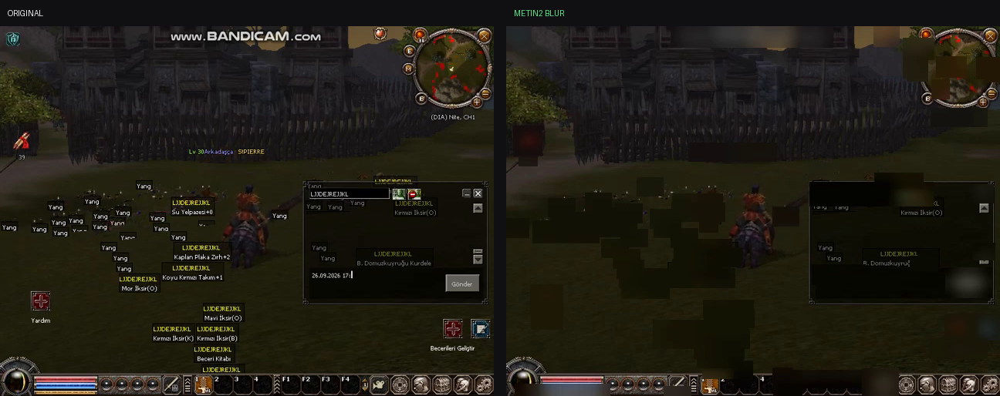
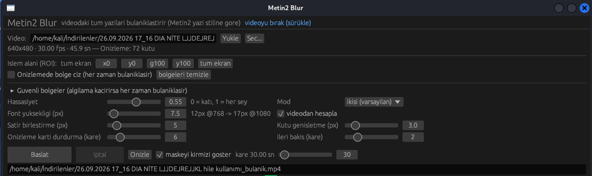

<div align="center">

# Metin2 Blur

**Yerel, çevrimdışı video metin redaksiyon aracı — Metin2 kayıtları için ayarlanmış.**
Tek dosya Windows çalıştırılabilir. Hiçbir şey hiçbir yere yüklenmez.

[English](README.md) · [Türkçe](README.tr.md)

</div>



*Sol: 640×480 Metin2 kaydı. Sağ: aynı karenin redakte edilmiş hâli — isim etiketleri,
uçan hasar sayıları, sohbet ve HUD yazıları bulanık. [Tam demo videosu →](https://github.com/OWNER/REPO/releases/download/v1.0.0/demo-redacted.mp4)*



*Önizlemede çizilen bölgeler (turuncu) koşulsuz bulanıklaştırılır; yeşil kutular o karede otomatik bulunanlardır.*

---

## Ne yapar

Bir video dosyası alır, ekrandaki **yazıyı** bulur ve o bölgeleri bulanıklaştırır.
Oyun kayıtlarını paylaşmadan önce isimleri, sohbeti ve hesap kimliklerini
gizlemek için kullanılır: hata raporu, oyun destek talebi (ticket), VOD ya da
yanındakilerin ve kendi hesabının adının görünmesini istemediğin her durum.

Bu bir **redaksiyon yardımcısıdır, garanti değildir.** Hassas bir şey için
kullanmadan önce [Sınırlar](#sınırlar) bölümünü oku ve çıktıyı kendin kontrol et.

## Metin2 kayıtlarında neden çalışıyor

Tespit OCR değil — karakter tanıma yok, bulut yok, model indirme yok. Sızan
client kaynaklarından Metin2'nin yazıyı çok belirli bir şekilde çizdiği görülüyor:

* `EterLib/GrpFontTexture.cpp` — glifler `ANTIALIASED_QUALITY` ile çizilip
  **1-bit maskeye eşikleniyor**, `A4R4G4B4` olarak yükleniyor ve çizim anında
  renkle modulate ediliyor. Ekranda bu, doku değil, **düz renk + yumuşak kenar**
  demek.
* `EterLib/GrpText.cpp` — font kaynakları `isim:12.fnt`, `14i.fnt` (italik),
  `18.fnt`; varsayılan **12 px**.
* `UserInterface/PythonTextTail.cpp` — isim etiketlerinde `SetOutline(true)`
  (siyah outline) ve yazının arkasında koyu kutu; renkler sabit liste (oyuncu
  beyaz, canavar kırmızı, guild `0xFFEFD4FF`, guild seviyeleri `CD661D`/`FFC125`,
  seviye renkleri `00FF7F`…`FF4500` …).

Bunun sonucu olan boru hattı:

```
kare → gri tonlamalı açma (erosion→dilation) → top-hat / black-hat  ← ince yapı tepkisi
     ∪ Metin2 palet çekirdeği (5-bit LUT)                          ← renkten gelen hatırlatma
     → yatay run birleştirme → bağlı bileşenler → satıra bölme
     → boyut / doluluk / satır içi boşluk / zaman-kararlılık filtreleri
     → bölge başına kutu bulanıklığı → ffmpeg ile yeniden kodlama
```

Kil işlem **gri tonlamalı açma**: sıradan yerel kontrast ölçümünün aksine kalın
parlak alanları (gökyüzü, arayüz panelleri) siler, glif çizgileri arasındaki
**boşlukları korur**; video sıkıştırması ve büyütmede sonra tutmasının sebebi bu.

> Palet eşleştirmesi **tek başına yetmez**: `yuv420p` kroma alt örneklemesi ve
> H.264 düz renkleri kaydırıyor, `(255,204,0)` altın ölçülebilir biçimde
> referanstan uzaklaşıyor. Bu yüzden tespiti yapı yapı taşıyor, palet sadece
> hatırlatma ekliyor.

## Kurulum

**Windows** — releases sayfasından `Metin2Blur.exe` indir. Kurulum tamamen bu:
ffmpeg yok, Python yok, ek çalıştırma kitaplığı yok. `ffmpeg.exe` binary'nin
içine gömülü ve ilk çalıştırmada `%LOCALAPPDATA%\metin2-blur\` altına açılıyor.
(İmzasız, yeni indirilen dosyada Windows SmartScreen uyarırsa
*Daha fazla bilgi → Yine de çalıştır*.)

**Linux** — `PATH` üzerinde ffmpeg gerekir:

```bash
cargo build --release
./target/release/metin2-blur
```

## Kullanım

1. Videoyu pencereye bırak ya da yolu yapıştırıp **Yükle**.
2. **Önizle** — bir kare çözülür, bulunan metin maskesi kırmızı, kutular yeşil
   çizilir. Önemli olan adım bu: umursadığın bir isim kutu içinde değilse
   üstüne bölge çiz.
3. İstersen **İşlem alanı (ROI)**'yi oyun penceresine ayarla; böylece duvar
   kağıdı, masaüstü araçları ve diğer pencereler tamamen devre dışı kalır.
4. **Başlat**. İlerleme çubuğu `kare n/toplam`, hız, bulunan bölge sayısı ve
   tahmini kalan süreyi gösterir. **İptal** durdurur.

### Bölgeler: en güvenilir yol

Metin2 arayüzü **sabit konumda** olduğu için, düz bir dikdörtgen çoğu zaman
otomatik tespitten daha isabetlidir — üstelik yanlış pozitifi olmaz:

* **Önizlemede bölge çiz** kutusunu aç, sohbetin / HUD'ın / envanterin
  üzerinden sürükle; en fazla 4 bölge.
* Her bölge her karede **koşulsuz** bulanıklaştırılır.

### Komut satırı

```
Metin2Blur.exe --cli <video> [cikti] [hassasiyet] [font_px] [roi] [mod] [bolgeler]

  hassasiyet  0 = katı, 1 = her şeyi yakala            (varsayılan 0.55)
  font_px      videodaki beklenen yazı yüksekliği, px   (varsayılan: 12 × yükseklik/768)
  roi          yüzde x,y,g,y                           (0,0,100,100 = tüm ekran)
  mod          ikisi | palet | yapi
  bolgeler     yüzde x,y,g,y;x,y,g,y — hep bulanıklaştırılır

örnek:
  Metin2Blur.exe --cli oyun.mp4 cikti.mp4 0.8 12 0,0,100,100 ikisi 0,46,55,30;16,7,20,5
```

`FFMPEG=/path/to/ffmpeg` gömülü binary'yi geçersiz kılar.

## Sınırlar

Tahmin değil, ölçüm — bu bölümü lütfen oku:

* **Küçük ve düşük kontrastlı yazıda otomatik tespit %100 değil.** Oyun
  penceresinin 8 px olduğu 640×480 masaüstü kaydında, 8 px yazı ile 3B sahne
  dokusunun kontrast dağılımları **örtüşüyor**; bazı uçan isim etiketleri
  geçiyor. Ölçülen değer: örneklenen 7 isim etiketi bölgesinden 4'ü orijinal
  keskinliğinin 0.84–1.00 arasında kaldı.
* Tam ekran kaydında çok daha güçlü (test: 7/7 metin bölgesi orijinal
  keskinliğin 0.01–0.04'üne indi, arayüz panelinde yanlış pozitif yok).
* **Okunamaması kesin olması gereken her şey için bölge kullan.** Sabit oyun
  düzeni tam bunun için var.
* Başarısızlık yönü aşırı bulanıklaştırmak: dokulu sahnelerde 3B manzarayı
  lekeleyebilir. Rahatsız ediyorsa hassasiyeti düşür ya da ROI ile sınırla.
* `font_px`'in ~3,2 katından uzun yazı arayüz paneli sayılıp atlanır.
* Palet toleransının pratik tabanı 12'dir (5-bit LUT).

## Hız

Bu makinede ölçüldü (release, 4 çekirdek, ffmpeg kodlaması dahil): 720p'de
saf tespit ~56 ms/kare, uçtan uca ~9–11 kare/sn. 45 saniyelik 30 fps kayıt
kabaca 3,5 dakika. Tespit tek iş parçacıklı; çözme ve kodlama ffmpeg'de paralel.

## Kaynaktan derleme

```bash
cargo test --release          # dedektör birim testi + 720p ölçümü
cargo build --release
./build-windows.sh            # rustup target + mingw-w64 + ffmpeg-win.exe gerekir
```

`ffmpeg-win.exe` repoda yok (82 MB); release iş akışı otomatik indirir.

## Lisans

MIT — [LICENSE](LICENSE).
